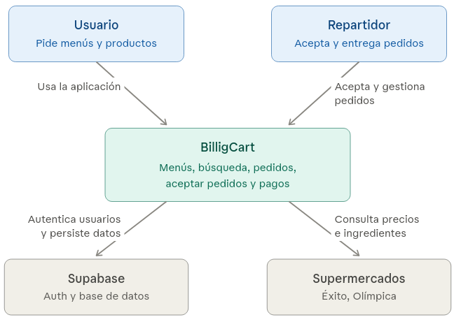
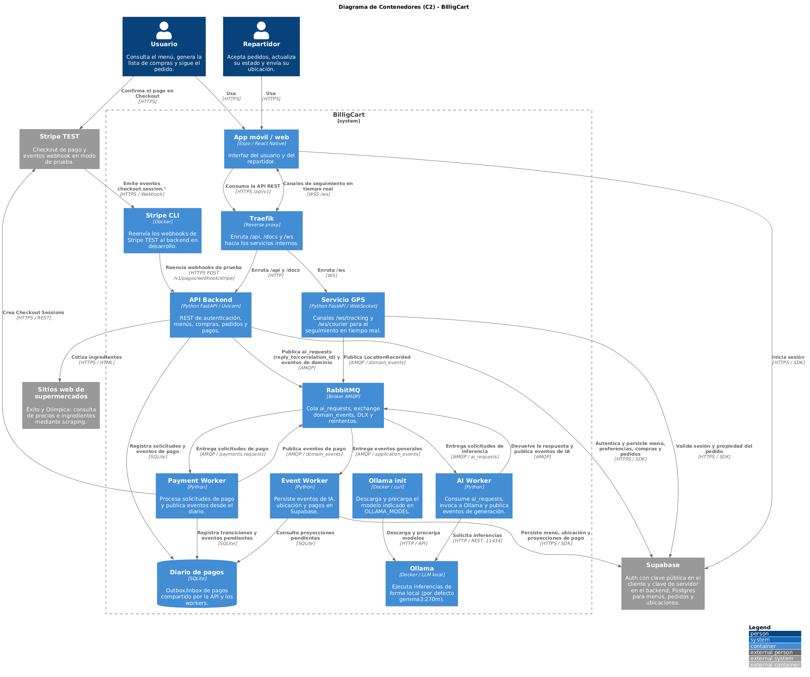

# BilligCart

BilligCart es una aplicación que genera menús semanalmente con inteligencia artificial, consulta precios de supermercados y persiste el menú, sus ingredientes y los pedidos en Supabase. La interfaz móvil y web se construye con Expo y consume la API del backend. La aplicación incluye pagos de prueba con Stripe, selección de productos para la lista de compras y seguimiento de pedidos mediante WebSocket.

## Tecnologías

- **Backend:** Python, FastAPI y Uvicorn.
- **Frontend:** React Native con Expo SDK 51 (`expo ~51.0.0`) y React Navigation.
- **Persistencia y autenticación:** Supabase.
- **Mensajería:** RabbitMQ, con la cola `ai_requests` y el exchange `domain_events`.
- **Generación con IA:** Ollama.
- **Pagos:** Stripe en modo TEST.
- **Ejecución de servicios:** Docker Compose, con Traefik como proxy inverso y un servicio independiente para WebSocket.

## Arquitectura del backend

El código se organiza en las capas `domain`, `application` e `infrastructure`. La capa `events` contiene los contratos, los handlers y el bus de eventos.

### Lista de compras

El cálculo se implementa en `src/application/use_cases/shopping.py`. Las cantidades se agregan en una unidad común mediante las conversiones definidas para kilogramos, gramos, litros, mililitros y unidades. El total se obtiene sumando un precio de referencia por ingrediente; el catálogo no incorpora el tamaño del empaque, por lo que el total no representa un coste calculado por gramos ni mililitros.

La confirmación exige un menú completo de 21 comidas. El caso de uso calcula una `checkout_key` a partir del menú y de los artículos seleccionados, y el repositorio realiza la operación de guardado mediante `upsert` por `user_id` y `checkout_key`. El cuerpo de `POST /compras/confirmar` admite `items_ids` para enviar la selección de artículos y `omitir_sin_precio` para excluir los ingredientes sin cotización. La interfaz activa de compras envía `items_ids`; el indicador `omitir_sin_precio` forma parte del contrato, pero no dispone de un control en la interfaz.

### Cotización de ingredientes

El endpoint autenticado `POST /api/v1/ingrediente/fetch/{id}` inicia la búsqueda de productos para un ingrediente. El frontend solicita una cotización cuando no existe un registro de `ultimos_fetch` o cuando su antigüedad es mayor o igual a siete días. El backend rechaza una nueva cotización cuando el ingrediente ya tiene tienda asignada y su último fetch es inferior a siete días.

El caso de uso `src/application/commands/ingrediente/scrape_ingrediente` coordina dos builders, correspondientes a Éxito y Olímpica, mediante un Director definido en `src/application/scraping/director_scraping.py`. El Director recibe la clase del builder, la instancia y ejecuta la extracción de nombre, precio y URL a partir de la respuesta HTTP. El caso de uso selecciona la oferta de menor precio y actualiza el catálogo.

### Generación del menú y eventos

El menú semanal comprende siete días con desayuno, almuerzo y cena: 21 comidas en total. La generación utiliza mensajería asíncrona:

1. El backend publica la solicitud en la cola `ai_requests` con `reply_to` y `correlation_id`, y espera la respuesta del worker.
2. `ai_worker` invoca a Ollama y devuelve el resultado mediante la cola de respuesta temporal.
3. Durante la generación, `ai_worker` publica los eventos `ai.menu_generation.started.v1`, `ai.menu_generation.completed.v1` o `ai.menu_generation.failed.v1` en el exchange `domain_events`.
4. `POST /api/v1/menu/generate` lee las preferencias, construye el prompt, espera la respuesta de la IA, persiste el menú y devuelve el resultado. El evento de finalización se publica con `persist_via_events=false` para evitar una segunda persistencia.
5. `POST /api/v1/ai/generate` mantiene la persistencia asíncrona a través de `event_worker`, con `persist_via_events=true` por defecto.
6. La cola principal `application_events` utiliza `domain_events.dlx` como exchange de mensajes fallidos. Los errores permanentes se publican en `application_events.dead`; los errores genéricos se reenvían a las colas `application_events.retry.5`, `application_events.retry.30` y `application_events.retry.300` según el número de reintentos.

Los contratos, la publicación, el registro de handlers y la integración con RabbitMQ se encuentran en `src/events/`. El frontend consume `/menu/generate` y recibe el menú persistido por la API.

### Pagos

La integración de Stripe opera en modo TEST. `POST /api/v1/pagos` exige la cabecera `Idempotency-Key` y acepta únicamente el identificador del pedido. El importe se obtiene del total guardado en Supabase, expresado en COP, y no se toma del cuerpo de la solicitud. `GET /api/v1/pagos/configuracion` informa del estado de la configuración con `mode: test`, `amount_source: order_total` y `requires_webhook: true`.

El servicio `payment_worker` procesa las solicitudes registradas en el diario de pagos y `stripe_cli` reenvía los eventos de Stripe a `POST /api/v1/pagos/webhook/stripe` sin requerir `stripe login` ni `stripe listen` manuales. La validación de configuración exige una clave `sk_test_`, un secreto de webhook `whsec_`, `PAYMENTS_SANDBOX_FIXTURES=true` y `PAYMENTS_TEST_CURRENCY=cop`.

### Seguimiento

El servicio `gps_service` expone los canales `/ws/tracking/{order_id}` y `/ws/courier/{order_id}` en el puerto interno 8001. Traefik enruta el prefijo `/ws` hacia ese servicio. El frontend abre el canal de seguimiento en el detalle del pedido y el canal del repartidor en la pantalla correspondiente.

## Puertos y servicios

| Servicio | Dirección | Uso |
|---|---|---|
| Frontend | `http://localhost:8081` (puerto predeterminado de Expo) | Interfaz de usuario |
| API mediante Traefik | `http://localhost/api/v1` | Rutas REST de la aplicación |
| API directa | `http://127.0.0.1:8000/v1` | Acceso local al backend |
| Documentación de la API | `http://localhost/docs` | Documentación interactiva |
| RabbitMQ AMQP | `rabbitmq:5672` | Comunicación interna entre servicios de Compose |
| Panel de RabbitMQ | `http://localhost:15672` | Administración y monitoreo |
| WebSocket | `ws://localhost/ws/...` | Seguimiento del pedido y del repartidor |

Docker Compose publica en el host los puertos 80, 15672 y `127.0.0.1:8000`. Los puertos 5672 y 11434 permanecen disponibles únicamente dentro de la red de Compose. En consecuencia, los servicios del backend se comunican con RabbitMQ mediante `rabbitmq:5672` y con Ollama mediante `ollama:11434`.

## Requisitos

- Docker y Docker Compose para el backend y los servicios asociados.
- Node.js en versión LTS y npm para el frontend.
- Python con las dependencias de `backend/requirements.txt` para ejecutar las pruebas fuera de Docker.
- Un proyecto de Supabase con sus credenciales de URL y clave de servidor.
- Un entorno compatible con el SDK 51 de Expo. La versión declarada en `frontend/package.json` es `expo ~51.0.0`.
- El modelo indicado por `OLLAMA_MODEL`, descargado y precargado por el servicio `ollama-init`.

## Configuración

1. Crear `backend/.env` a partir de `backend/.env-example` y sustituir los valores de ejemplo por los valores del entorno.
2. Crear `frontend/.env` a partir de `frontend/.env.example` y configurar la URL de Supabase, la clave pública, la URL de la API y la URL de WebSocket.
3. Verificar que el proyecto de Supabase dispone del esquema y de los permisos utilizados por los repositorios del backend. El repositorio no incluye scripts SQL de aprovisionamiento.

Las variables declaradas en `backend/.env-example` son:

```env
SUPABASE_URL=https://XXXXXXXXXXXX.supabase.co
SUPABASE_KEY=SECRET_KEY

RABBITMQ_USER=XXXXXXXX
RABBITMQ_PASSWORD=XXXXXXXX
RABBITMQ_QUEUE=ai_requests
RABBITMQ_HOST=rabbitmq
RABBITMQ_PORT=5672

OLLAMA_MODEL=gemma4:e4b

RABBITMQ_EVENT_EXCHANGE=domain_events
RABBITMQ_EVENT_DEAD_LETTER_EXCHANGE=domain_events.dlx
RABBITMQ_EVENT_QUEUE=application_events
RABBITMQ_VHOST=/

STRIPE_SECRET_KEY=
STRIPE_WEBHOOK_SECRET=
STRIPE_SUCCESS_URL=http://localhost:8081/?stripe_return=success
STRIPE_CANCEL_URL=http://localhost:8081/?stripe_return=cancel
PAYMENTS_SANDBOX_FIXTURES=true
PAYMENTS_TEST_CURRENCY=cop
PAYMENTS_JOURNAL_PATH=./.payment-data/journal.sqlite3
```

`SUPABASE_KEY` corresponde a una clave de servidor. El frontend emplea únicamente la clave pública de Supabase Auth definida en `frontend/.env.example`:

```env
EXPO_PUBLIC_SUPABASE_URL=https://TU-PROYECTO.supabase.co
EXPO_PUBLIC_SUPABASE_ANON_KEY=sb_publishable_yDW9bvAKY7O-1ZSEWyZyzg_vZiYaPUt

EXPO_PUBLIC_API_URL=http://localhost/api/v1
EXPO_PUBLIC_WS_URL=http://localhost
```

El valor predeterminado de `OLLAMA_MODEL` en Docker Compose es `gemma3:270m` cuando la variable no está definida en `.env`. El servicio `ollama-init` descarga el modelo indicado, lo precarga con `keep_alive=-1` y el servicio `ollama` mantiene `OLLAMA_KEEP_ALIVE=-1`. La retención puede verificarse con `docker compose exec ollama ollama ps`; la columna `UNTIL` indica `Forever` mientras el modelo permanece cargado.

## Ejecución

El backend y el frontend se ejecutan en terminales independientes.

### 1. Backend y servicios de Docker Compose

Desde la carpeta `backend`:

```bash
docker compose up -d --build
```

Compose inicia `backend`, `ai_worker`, `event_worker`, `payment_worker`, `stripe_cli`, `rabbitmq`, `ollama`, `ollama-init`, `traefik`, `socket-proxy` y `gps_service`. Para consultar los registros de los servicios principales:

```bash
docker compose logs -f backend ai_worker event_worker payment_worker stripe_cli
```

Para detener los servicios:

```bash
docker compose down
```

El servicio `stripe_cli` valida que `STRIPE_SECRET_KEY` comience con `sk_test_` y reenvía los eventos `checkout.session.completed`, `checkout.session.expired`, `checkout.session.async_payment_succeeded` y `checkout.session.async_payment_failed` a `http://backend:8000/v1/pagos/webhook/stripe`.

### 2. Frontend con Expo

Desde la carpeta `frontend`:

```bash
npm install
npx expo start
```

Para iniciar el servidor de desarrollo con túnel y limpiar la caché:

```bash
npx expo start --tunnel --clear
```

En la versión web, el proxy de Metro reenvía `/api/v1` al backend local en `127.0.0.1:8000` mediante `BACKEND_PORT`, con valor predeterminado 8000, y transforma el prefijo `/api/v1` en `/v1`. Las conexiones WebSocket se enrutan mediante Traefik en el puerto 80. En móvil, la API utiliza `EXPO_PUBLIC_API_URL` y el WebSocket utiliza `EXPO_PUBLIC_WS_URL`; si esta última variable no está definida, `frontend/src/services/api.js` deriva la dirección del WebSocket a partir de `EXPO_PUBLIC_API_URL`.

## Funcionalidad y rutas

### Menú y preferencias

La generación del menú depende de las preferencias almacenadas. Si la lectura de preferencias falla, la generación se detiene. Las preferencias se consultan y se actualizan mediante `GET /preferencias` y `PUT /preferencias`. El menú semanal se obtiene mediante `GET /menu/weekly`.

### Compras y pedidos

`GET /compras` devuelve los ingredientes agregados del menú, `ultimos_fetch` por identificador de ingrediente, `menu_completo` y `precios_pendientes`. La pantalla `CarritoScreen` recarga la lista al entrar, ofrece la acción «Actualizar precios» y permite seleccionar los artículos con precio disponible.

La confirmación requiere el menú completo. Si hay pedidos, `PedidosScreen` muestra el listado cuando existen varios y abre directamente el detalle cuando existe uno solo. El detalle consulta el estado guardado cada cinco segundos, muestra el repartidor asignado y habilita el pago y el seguimiento por WebSocket. Los valores de `estado` son `pendiente`, `confirmado`, `en_camino` y `entregado`; el repositorio lee esa columna como fuente del estado del pedido.

### Cuentas y roles

Las rutas de negocio autenticadas exigen `Authorization: Bearer <access_token>`. La propiedad de menús, platos, relaciones y pedidos se verifica contra el usuario autenticado. `POST /auth/register` admite los roles `user` y `repartidor`, los persiste en `public."Roles"` y devuelve la sesión cuando Supabase no exige confirmación de correo. El rol `admin` no se puede asignar mediante el registro; se requiere para crear, editar o eliminar ingredientes.

El backend resuelve el rol desde la columna `rol` de `public."Roles"` y no concede permisos a partir de `user_metadata` ni `app_metadata`. En el frontend, `AuthContext` emplea `app_metadata.role` como respaldo para la navegación cuando `GET /auth/me` no devuelve un usuario; las decisiones de autorización se aplican en el backend.

### Tabla de rutas

Las rutas se indican relativas a `/api/v1`.

| Ruta | Uso |
|---|---|
| `GET /health` | Comprobación de estado del backend |
| `POST /auth/register`, `POST /auth/login`, `GET /auth/me` | Registro, inicio de sesión y usuario autenticado con su rol |
| `POST /ai/generate` | Generación con persistencia asíncrona mediante eventos |
| `GET /menu/current`, `GET /menu/weekly`, `POST /menu/generate`, `POST /menu/create`, `GET /menu/date/{date}` | Consulta, generación y creación de menús |
| `POST /plato/create`, `PUT /plato/update/{id}`, `GET /plato/day/{day}`, `DELETE /plato/delete/{id}` | Gestión de platos |
| `POST /ingrediente/create`, `PUT /ingrediente/update/{id}`, `GET /ingrediente/get/{id}`, `DELETE /ingrediente/delete/{id}` | Catálogo de ingredientes, restringido a `admin` para escritura |
| `POST /ingrediente/fetch/{id}` | Cotización de un ingrediente |
| `POST /plato-ingrediente/create`, `POST /plato-ingrediente/create-many`, `PATCH /plato-ingrediente/update/{id}`, `GET /plato-ingrediente/get/{id}`, `GET /plato-ingrediente/get-by-plato/{plato_id}`, `DELETE /plato-ingrediente/delete/{id}`, `DELETE /plato-ingrediente/delete-by-plato/{plato_id}` | Gestión de la relación entre platos e ingredientes |
| `GET /preferencias`, `PUT /preferencias` | Consulta y actualización de preferencias propias |
| `GET /compras`, `POST /compras/confirmar` | Lista de compras y registro del pedido |
| `GET /pedidos`, `GET /pedidos/current`, `GET /pedidos/{id}/estado`, `PUT /pedidos/{id}/envio` | Consulta de pedidos y registro de la dirección de entrega |
| `GET /repartidor/pedidos/disponibles`, `GET /repartidor/pedidos/asignados`, `POST /repartidor/pedidos/{id}/aceptar`, `PATCH /repartidor/pedidos/{id}/estado` | Operaciones del repartidor |
| `POST /pagos`, `GET /pagos/pedido/{order_id}`, `GET /pagos/configuracion`, `POST /pagos/webhook/stripe` | Solicitud, consulta, configuración y confirmación de pagos |

Los canales WebSocket `/ws/tracking/{order_id}` y `/ws/courier/{order_id}` se sirven fuera del prefijo `/api/v1`.

## Registro de solicitudes

El middleware de la API genera un identificador para cada solicitud, lo devuelve en la cabecera `X-Request-ID` y registra método, ruta, estado y duración. No registra contraseñas, tokens ni cuerpos de solicitud. Los detalles de los errores de persistencia quedan en los registros del servidor y la respuesta al cliente utiliza un mensaje genérico.

## Comprobaciones

Desde `backend`, con las dependencias de `requirements.txt` instaladas:

```bash
python -m unittest discover -s tests -v
```

La suite está compuesta por 11 módulos de pruebas. Emplea repositorios y servicios externos simulados, y cubre reglas de dominio, generación, persistencia, preferencias, compras, autorización, registro de solicitudes, pagos, eventos y GPS. La ejecución predeterminada no requiere credenciales reales. La prueba `test_payments_broker.py` se omite salvo que se defina `PAYMENTS_BROKER_TEST=1` y se disponga de un broker de RabbitMQ accesible. También se admite la ejecución con `python -m pytest` empleando las dependencias de `backend/requirements-dev.txt`.

Desde `frontend`:

```bash
npm run lint
npx expo export --platform web --output-dir dist --max-workers 1
```

El script `lint` ejecuta ESLint con la configuración de Expo. El comando de exportación genera la versión web mediante Metro.

## C4 Models

### Nivel 1



### Nivel 2



### Nivel 3


